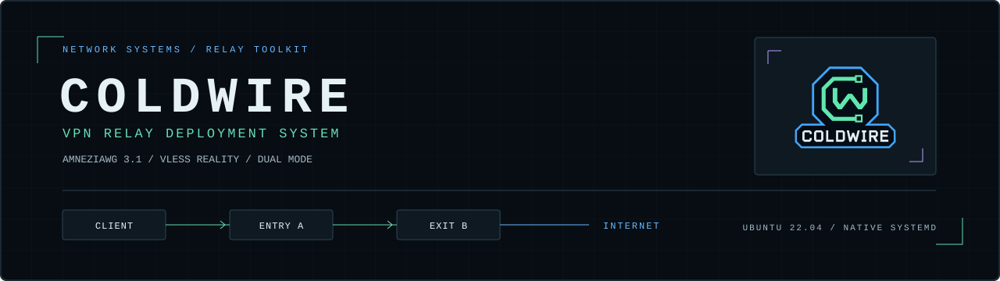
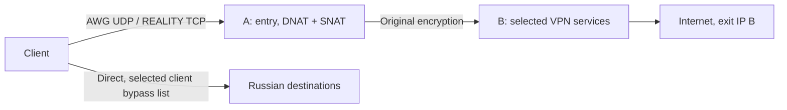

# COLDWIRE

VPN RELAY DEPLOYMENT SYSTEM



[Русский](README.md) · **English**

Automated deployment of two VPS instances: clients connect to entry A, while
websites see exit B's address. Choose **AmneziaWG 3.1**, **VLESS + REALITY +
XTLS Vision**, or **both protocols**. Clients can send Russian IPv4 destinations
from a selected bypass list directly through their own ISP.

**Supported server OS: Ubuntu 22.04 amd64. Other versions have not been tested
and are rejected by the installers.** Use two different clean VPS instances
with systemd, assigned public IPv4 addresses, SSH and root/sudo access. AWG
requires TUN on B. Additional provider-side NAT is not supported by the normal
deployment mode. The test VMs each had 1 vCPU and 1 GiB RAM.

No Docker, Go SDK or control panel is installed on either VPS. A forwards the
encrypted traffic using nftables without a persistent proxy process. Selected
native systemd services run on B, with separate AWG/Xray keys and directories.

The project is named COLDWIRE. Internal path, environment and systemd names
using `awg-relay-kit` and `blackice-relay` are retained for compatibility.
Use the exact command paths documented here.



## Deploy from your computer

The operator computer needs Python **3.10+** with venv/pip. Windows PowerShell:

```powershell
powershell -NoProfile -ExecutionPolicy Bypass -File .\setup.ps1
```

Linux/macOS:

```bash
bash setup.sh
```

The launcher installs operator dependencies. The wizard asks for **the protocol,
IPv4 address, SSH port, username and hidden password for each server**. It
generates keys, UUIDs, shortIds, a suitable TLS target, configuration and client
exports. Password-protected sudo uses the SSH password by default. Missing
Python/iproute2/OpenSSL/CA packages are bootstrapped on the servers.

| Mode | Default entry A | Exit B |
|---|---|---|
| AWG | 32497/UDP | AmneziaWG 3.1 |
| REALITY | 443/TCP | VLESS + REALITY + XTLS Vision |
| Both | Both ports | Two independent services |

If SSH occupies TCP443, the wizard may select free TCP8443 without changing
SSH. Other conflicts fail safely. Explicit VPN ports are available as CLI
options. Allow SSH and the selected VPN ports in your provider firewall first;
the script has no provider API integration. Existing VPNs, active UFW and
foreign nftables rules are not migrated: deployment requires clean VPS instances.

Unknown SSH keys are saved using trust on first use (TOFU); a changed known key
is rejected before password authentication. Supply known fingerprints for
independent verification. [Options, SSH trust and deployment sequence](docs/en/deploy.md).

Results go into a new `private/deployment-<time>-<suffix>/` directory: direct
and via-entry exports for the chosen protocols, two bypass JSON files and a
private report. Passwords are not written to the report. A has a five-minute
rollback timer, cancelled only after every selected protocol passes its probe.
If Xray installation fails in both mode, already downloaded AWG exports remain.

The operator computer's VPN and routes are not changed. Client import and
device-network checks are separate. Native installation creates client access;
server administration uses SSH/CLI, not an Amnezia administrator profile. Both
mode provides two connections for the user to choose from in their client.

## Clients and maintenance

On B installed by the wizard:

```bash
sudo python3 /opt/awg-relay-kit/install_exit.py add-client --name phone
sudo python3 /opt/awg-relay-kit/install_xray.py add-client --name phone
```

Run the command for the required protocol. AWG produces `.vpn`/`.conf`; Xray
produces JSON and a TXT containing `vless://`, including via-entry variants.
Issue separate access for each device. Adding an Xray client briefly restarts
only Xray. AWG peers are added without restarting its server process.

To convert a separate AWG profile issued by the Amnezia application on another exit:

```powershell
python .\convert_profile.py "C:\secure\client.vpn" "C:\secure\client-via-entry.vpn" --entry ENTRY_IPV4
```

For a native Xray JSON:

```powershell
python .\convert_xray.py "C:\secure\client.json" "C:\secure\client-via-entry.json" --entry ENTRY_IPV4
```

`ENTRY_IPV4`/`EXIT_IPV4` are your own addresses; the toolkit contains no
preconfigured deployment nodes. Converters preserve credentials and create a
new file; they do not install servers. [Profiles and import](docs/en/profiles.md),
[relay and rollback](docs/en/servers.md), [AWG and backup/restore](docs/en/native-server.md),
[Xray and backup/restore](docs/en/xray.md).

## Russian destinations directly

In AmneziaVPN, import **one** JSON into the website list for destinations
**outside the VPN**, using **Replace list**. These are alternative policies;
do not merge them.

| File | Prefixes | Calculated Android <13 routes | Policy |
|---|---:|---:|---|
| `ru-direct.amnezia.json` | 1097 | 2004 | All source RU/local networks plus 111,284,160 addresses outside that source set |
| `ru-services.amnezia.json` | 77 | 751 | RU allocations covering selected services, plus local networks |

`ru-direct` deliberately bypasses the VPN for some foreign addresses. A user
reported it working on a phone; the imported file's hash was not independently
checked. The generic snapshots contain no preconfigured VPN nodes.

```powershell
python .\update_lists.py --output .\generated\fresh-lists
python .\update_lists.py --offline --output .\generated\snapshot
```

Each command requires a new destination directory and produces exactly two
JSON files. Optional `--entry ENTRY_IPV4 --exit EXIT_IPV4` protects those nodes
from inclusion in bypass. [Coverage, limits and checksums](docs/en/lists.md).

## Verification and limitations

```powershell
.\.venv\Scripts\python.exe -m unittest discover -s tests -v
```

Network checks of all three modes, reboot, backup/restore, authorization,
service independence and resource measurements are in the [VM report](docs/en/validation-protocols.md).
A short 1 vCPU / 1 GiB run does not establish a client-count or throughput
limit. An earlier AWG cycle has its [own report](docs/en/validation-native.md).

The relay separates entry and exit while preserving the original encryption.
It adds no second tunnel layer and does not guarantee DPI evasion or protection
against traffic correlation. REALITY is checked as a TLS-like transport, not
as universally undetectable. AWG on UDP443 does not become HTTPS. The common
AWG default is 32497, informed by the [AdGuard compatibility observation](docs/en/windows-admin-port-diagnosis.md).

The toolkit implements IPv4 egress. Check DNS/DoH, IPv6 and KillSwitch behavior
on each client. Split routing is a client function; a server cannot send a
destination through the device's ISP on its behalf. [Troubleshooting](docs/en/troubleshooting.md),
[primary sources](docs/en/sources.md).

Keep profiles, backups and logs outside Git, including private repositories.
`.vpn` is compressed JSON, not a protected vault; administrator exports may
contain SSH access. Restrict the output directory with NTFS ACLs on Windows.
Bundled binaries retain pinned checksums and licenses. Review the source tree
and history before sharing. [Publication guide](docs/en/publication.md).

Original project scripts, tests, documentation and branding are available under the
[MIT license](LICENSE). Third-party components and address data
retain their own terms: [licenses and provenance](THIRD_PARTY_NOTICES.md).
