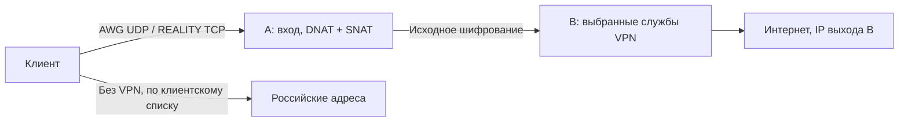

# COLDWIRE

VPN RELAY DEPLOYMENT SYSTEM


**Русский** · [English](README.en.md)

Автоматическая установка двух VPS: клиент подключается к входу A, сайты видят
адрес выхода B. При установке выбирается **AmneziaWG 3.1**, **VLESS + REALITY +
XTLS Vision** или **оба протокола**. Российские IPv4 из выбранного списка клиент
может направлять напрямую через своего провайдера.

**Поддерживается Ubuntu 22.04 amd64. Остальные версии не тестировались и
отклоняются установщиками.** Нужны два разных чистых VPS с systemd, публичными
IPv4 на интерфейсах, SSH и root/sudo. Для AWG на B нужен TUN. Дополнительный NAT
у хостера обычным режимом не поддерживается. Стенд — VM по 1 vCPU / 1 ГБ RAM.

На VPS нет Docker, Go SDK или панели управления. A пересылает зашифрованный
трафик через nftables без постоянного процесса прокси; на B работают выбранные
нативные службы systemd. Xray и AWG используют разные службы, ключи и каталоги.

Название проекта — COLDWIRE. Служебные имена `awg-relay-kit` и
`blackice-relay` в путях, переменных и systemd сохранены для совместимости;
используйте команды с теми именами, которые указаны в документации.



## Установка с компьютера

Нужен Python **3.10+** с venv/pip на компьютере оператора. Windows PowerShell:

```powershell
powershell -NoProfile -ExecutionPolicy Bypass -File .\setup.ps1
```

Linux/macOS:

```bash
bash setup.sh
```

Лаунчер устанавливает зависимости оператора. Мастер спрашивает **протокол,
IPv4, SSH-порт, логин и скрытый пароль каждого сервера**. Остальное генерируется
автоматически: ключи, UUID, shortId, подходящая TLS-цель, настройки и профили.
При парольном sudo по умолчанию используется введённый пароль SSH.
На VPS недостающие Python/iproute2/OpenSSL/CA устанавливаются автоматически.

| Режим | Вход A по умолчанию | Выход B |
|---|---|---|
| AWG | 32497/UDP | AmneziaWG 3.1 |
| REALITY | 443/TCP | VLESS + REALITY + XTLS Vision |
| Оба | Оба порта | Обе независимые службы |

Если TCP443 занят SSH, мастер может выбрать свободный 8443; SSH не меняется.
Иные конфликты приводят к отказу. Явные VPN-порты задаются параметрами.
Разрешите SSH и выбранные VPN-порты в firewall хостера заранее: без API хостера
скрипт его не настраивает. Действующие VPN, активный UFW и чужие nftables
не мигрируются; для установки нужны чистые VPS.

Первый неизвестный SSH-ключ сохраняется по TOFU; изменённый ключ отвергается
до передачи пароля. Для независимой проверки задайте известные отпечатки.
[Параметры, SSH-доверие и порядок установки](docs/deploy.md).

Результат — новая папка `private/deployment-<время>-<суффикс>/`: прямые и
via-entry профили выбранных протоколов, два JSON исключений и закрытый отчёт.
Пароли в отчёт не записываются. На A действует пятиминутный таймер отката;
он отменяется только после успешных проверок всех выбранных протоколов.
Если Xray не установился в режиме «оба», уже скачанные AWG-профили сохраняются.

VPN на компьютере оператора не переключается, маршруты не меняются.
Импорт и проверка с устройства выполняются отдельно. Нативная установка выдаёт
клиентские доступы, управление серверами — через SSH/CLI, без административной
роли Amnezia. В режиме «оба» это два подключения на выбор в клиенте.

## Клиенты и обслуживание

На B, установленном мастером:

```bash
sudo python3 /opt/awg-relay-kit/install_exit.py add-client --name phone
sudo python3 /opt/awg-relay-kit/install_xray.py add-client --name phone
```

Запускайте команду нужного протокола. AWG выдаёт `.vpn`/`.conf`, Xray — JSON и
`vless://` в TXT, в том числе вариант через A. Для каждого устройства создавайте
отдельный доступ. Добавление клиента Xray кратко перезапускает только Xray;
AWG обновляется без перезапуска своего процесса.

Для отдельного AWG-профиля, выданного приложением на другом выходе:

```powershell
python .\convert_profile.py "C:\secure\client.vpn" "C:\secure\client-via-entry.vpn" --entry ENTRY_IPV4
```

Конвертер Xray для нативного JSON:

```powershell
python .\convert_xray.py "C:\secure\client.json" "C:\secure\client-via-entry.json" --entry ENTRY_IPV4
```

`ENTRY_IPV4`/`EXIT_IPV4` — ваши адреса; заранее настроенных узлов в комплекте нет.
Конвертеры сохраняют доступы и создают новый файл; серверы они не устанавливают.
[Профили и импорт](docs/profiles.md), [реле и откат](docs/servers.md),
[AWG, backup/restore](docs/native-server.md), [Xray, backup/restore](docs/xray.md).

## Российские адреса напрямую

В AmneziaVPN импортируйте **один** JSON в список сайтов **без VPN**, через
«Заменить список». Это альтернативные варианты, объединять их не нужно.

| Файл | Подсетей | Расчёт маршрутов Android <13 | Политика |
|---|---:|---:|---|
| `ru-direct.amnezia.json` | 1097 | 2004 | Все исходные RU/локальные сети и дополнительно 111 284 160 адресов вне исходного набора |
| `ru-services.amnezia.json` | 77 | 751 | RU-выделения выбранных сервисов и локальные сети |

`ru-direct` допускает прямой доступ к части зарубежных адресов. Работа на
телефоне подтверждена ручной проверкой пользователя; хеш импортированного
файла отдельно не сверялся. Общие снимки не содержат настроенных VPN-узлов.

```powershell
python .\update_lists.py --output .\generated\fresh-lists
python .\update_lists.py --offline --output .\generated\snapshot
```

Каждая команда требует новую папку и создаёт ровно два JSON. Необязательные
`--entry ENTRY_IPV4 --exit EXIT_IPV4` защищают узлы от включения в bypass.
[Покрытие, ограничения, хеши](docs/lists.md).

## Проверки и ограничения

```powershell
.\.venv\Scripts\python.exe -m unittest discover -s tests -v
```

Сетевые проверки трёх режимов, reboot, backup/restore, авторизация, отсутствие
конфликтов и измерения ресурсов описаны в [отчёте VM](docs/validation-protocols.md).
Короткая проверка на 1 vCPU / 1 ГБ не устанавливает предел числа клиентов
или скорости. Более ранний цикл AWG — [отдельный отчёт](docs/validation-native.md).

Реле разделяет вход и выход, сохраняя исходное шифрование. Оно не добавляет
слой туннеля и не гарантирует обход DPI или защиту от корреляции. REALITY
проверяется как TLS-подобный транспорт, но универсальной необнаружимости нет.
AWG на UDP443 не становится HTTPS; общий порт AWG выбран 32497 с учётом
[наблюдения о совместимости AdGuard](docs/windows-admin-port-diagnosis.md).

Комплект реализует IPv4-выход. DNS/DoH, IPv6 и KillSwitch проверяйте на каждом
клиенте. Раздельную маршрутизацию выполняет клиент, сервер не может подменить
её выходом через провайдера устройства. [Диагностика](docs/troubleshooting.md),
[первичные источники](docs/sources.md).

Профили, backup и логи храните вне Git, даже приватного. `.vpn` — сжатый JSON,
не защищённое хранилище; административный экспорт может содержать SSH-доступ.
На Windows закрывайте папку результата NTFS ACL. В дистрибутив включены
бинарники с закреплёнными хешами и лицензиями; проверяйте дерево и историю
перед передачей коллегам. [Подготовка исходников](docs/publication.md).

Оригинальные скрипты, тесты, документация и оформление проекта доступны по
[лицензии MIT](LICENSE). Сторонние компоненты и адресные данные
не перелицензируются: [лицензии и источники](THIRD_PARTY_NOTICES.md).
