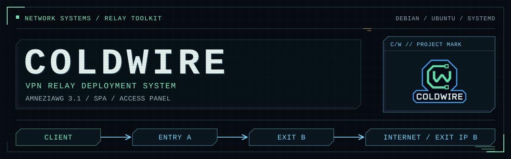
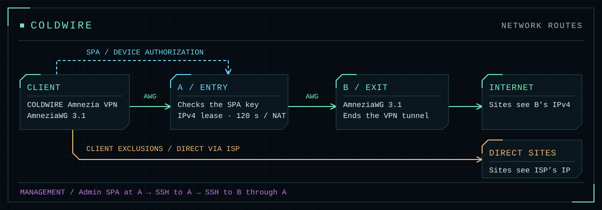

[Русский](README.ru.md)

COLDWIRE sets up an AmneziaWG 3.1 VPN across two servers. The client asks the entry node for access using Single Packet Authorization (SPA). The entry node forwards AmneziaWG packets to the exit node, where the tunnel ends. Sites reached through the tunnel see the exit node’s IPv4.

[Download the access panel](https://github.com/bgunn9in/coldwire/releases/latest) · [Set up the servers](docs/access-panel.md) · [Install the VPN client](https://github.com/bgunn9in/COLDWIRE-amnezia-client/blob/feature/spa-admission/docs/spa.md)

The panel diagnostics preview adds a relay health report for A and B. [Download the preview](https://github.com/bgunn9in/coldwire/releases/tag/preview-panel-diagnostics-20261128) · [Save a report](docs/access-panel.md#save-a-diagnostic-report)

## How it works

The client proves that it holds a device key and can receive a reply at its public IPv4. A then lets that address reach the relay for two minutes. The app renews access while connected. A forwards the encrypted tunnel packets using DNAT and SNAT. B runs AmneziaWG and handles internet traffic. Traffic on the client’s split-tunneling exclusion list goes directly through its usual connection.

The panel uses a separate SPA key for SSH. It connects to A with an SSH key and reaches B through A. B’s WAN firewall accepts VPN and SSH traffic from A’s IPv4.

## Installation

Use two amd64 servers running Ubuntu 22.04, 24.04 or 26.04 LTS, or Debian 12 or 13. COLDWIRE runs directly under systemd on both servers, without Docker.

The installer also serves as the administration panel. Run it on Windows or one of the supported Linux releases with CPython 3.10 or newer and the OpenSSH client.

1. Download and extract `COLDWIRE-Access-Panel.zip` from the [latest release](https://github.com/bgunn9in/coldwire/releases/latest).
2. Open `COLDWIRE-Admin.cmd` on Windows or run `bash COLDWIRE-Admin.sh` on Linux. For a new installation, choose **Install COLDWIRE** and enter each VPS’s IPv4 address, SSH username and password. Append `:port` if SSH uses a port other than 22.
3. Import the generated `client1.vpn` in [COLDWIRE Amnezia VPN](https://github.com/bgunn9in/COLDWIRE-amnezia-client/releases/latest). Connect and check that a site reached through the VPN sees B’s IPv4.

Use the same panel to issue profiles, manage access and back up the relay. [Panel guide](docs/access-panel.md)

Choose **12 Update split-tunneling lists** in the panel to refresh the two AmneziaVPN exclusion files. You can also run the generator on Windows or Linux. [Split-tunneling guide](docs/lists.md)

See [sources](docs/sources.md) for address data and upstream software and [third-party notices](THIRD_PARTY_NOTICES.md) for licenses.
