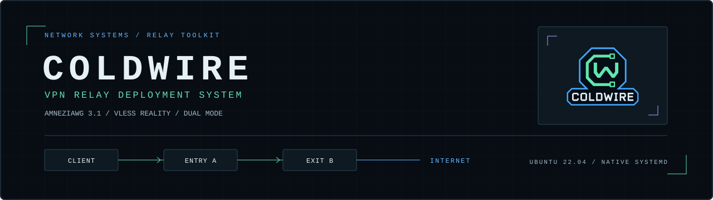
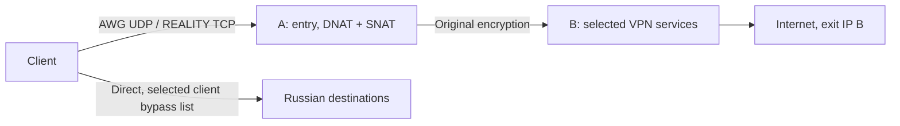

# COLDWIRE

VPN RELAY DEPLOYMENT SYSTEM



English | [Русский](README.ru.md)

COLDWIRE sets up a VPN across two Ubuntu servers. Your devices connect to
entry A, and websites see exit B's IP address. You can install AmneziaWG 3.1,
VLESS with REALITY and XTLS Vision, or both.

The entry server forwards encrypted traffic with nftables. The VPN services
run on the exit server under systemd. The exit uses prebuilt binaries;
the installer adds no Docker, Go SDK or control panel. AWG and Xray have
separate services, keys and configuration files.



## Installation

You need two clean Ubuntu **22.04, 24.04 or 26.04 LTS amd64** VPS instances
with public IPv4 addresses assigned to their network interfaces. Each must
allow SSH access as root or with sudo. AWG also needs TUN on the exit server.
Other OS releases and VPS instances behind additional provider NAT are
unsupported. For a 26.04 cloud image built for amd64v3, the VPS must expose
the required CPU features. [Platform checks](docs/validation-lts.md).

Install Python 3.10+ with venv/pip on your computer, then run one of these
commands from the repository folder.

Windows PowerShell:

```powershell
powershell -NoProfile -ExecutionPolicy Bypass -File .\setup.ps1
```

Linux/macOS:

```bash
bash setup.sh
```

The wizard asks which protocol to install and requests each server's IPv4,
SSH port, username and password. Password input is hidden. It installs missing
server packages, generates keys and REALITY settings, and saves client profiles.
For password-protected sudo, it uses the SSH password unless you provide a
separate one.

| Mode | Default entry ports | Services on the exit |
|---|---|---|
| AWG | 32497/UDP | AmneziaWG 3.1 |
| REALITY | 443/TCP | VLESS + REALITY + XTLS Vision |
| Both | Both ports | AWG and Xray |

Allow SSH and the selected VPN ports in your provider firewall before running
the installer. It cannot change that firewall through SSH alone. If SSH uses
TCP443, the wizard can select a free TCP8443; other port conflicts stop the
installation. You can also set VPN ports explicitly.

The installer requires clean servers and refuses existing toolkit state,
active UFW or foreign nftables tables. The wizard trusts the first SSH key
it receives and rejects later changes before sending a password. To verify
first contact independently, provide known SSH fingerprints.
[Installation options and SSH verification](docs/deploy.md).

## Client profiles

Results are saved in a new `private/deployment-<time>-<suffix>/` folder,
including direct and via-entry profiles, the two RU lists and a deployment
report. The report and profiles do not contain SSH passwords.

Import `client-via-entry.vpn` for AWG or `xray-client-via-entry.json` for
REALITY. Xray also has a TXT export containing a `vless://` URI. Keep the
direct profile as a fallback. Each device needs its own access; direct and
via-entry files for one protocol use the same client identity. In both mode,
import the protocols as separate connections and choose one in your client.

A five-minute timer rolls back the entry if setup is not confirmed. The
wizard confirms it after all selected protocol checks pass. If Xray setup
fails after AWG has been installed, the AWG profiles already downloaded remain
available. The installer does not switch your computer's VPN or change its routes.

Server administration uses SSH and the supplied CLI tools. Generated profiles
have a client role in AmneziaVPN. See [profile formats and import](docs/profiles.md).

## Add a device

On an exit installed by the wizard, run the command for the protocol you need:

```bash
sudo python3 /opt/awg-relay-kit/install_exit.py add-client --name phone
sudo python3 /opt/awg-relay-kit/install_xray.py add-client --name phone
```

AWG adds a peer without restarting the server process. Adding an Xray client
restarts Xray briefly; AWG keeps running. See [AWG maintenance](docs/native-server.md)
and [Xray maintenance](docs/xray.md) for backups and restore.

## Convert an existing profile

For an AWG export issued by the Amnezia application on another exit:

```powershell
python .\convert_profile.py "C:\secure\client.vpn" "C:\secure\client-via-entry.vpn" --entry ENTRY_IPV4
```

For a native Xray client JSON:

```powershell
python .\convert_xray.py "C:\secure\client.json" "C:\secure\client-via-entry.json" --entry ENTRY_IPV4
```

Replace `ENTRY_IPV4` with the entry address. Both converters preserve client
credentials and write a new file. They do not install servers. The AWG
converter also preserves the management address of an administrator export.
[Conversion details](docs/profiles.md).

## Send Russian traffic directly

In AmneziaVPN, select the website-list mode that bypasses the VPN and import
one of these files using **Replace list**. Do not merge them.

| File | Prefixes | Calculated Android <13 routes | Coverage |
|---|---:|---:|---|
| `ru-direct.amnezia.json` | 1097 | 2004 | All source RU/local networks, plus 111,284,160 addresses outside that set |
| `ru-services.amnezia.json` | 77 | 751 | RU allocations for selected services, plus local networks |

The compact `ru-direct` list deliberately sends some foreign addresses outside
the VPN. A user reported it working on a phone, but the imported file's hash
was not checked. The supplied files contain no configured VPN nodes.

To fetch current data or reproduce the supplied lists offline:

```powershell
python .\update_lists.py --output .\generated\fresh-lists
python .\update_lists.py --offline --output .\generated\snapshot
```

Each command creates exactly two JSON files in a new folder. Optional
`--entry ENTRY_IPV4 --exit EXIT_IPV4` protects those addresses from bypass.
[Coverage, route limits and checksums](docs/lists.md).

## Tests and limits

```powershell
.\.venv\Scripts\python.exe -m unittest discover -s tests -v
```

All three modes were tested on Ubuntu **22.04, 24.04 and 26.04 LTS** VMs
with 1 vCPU and 1 GiB RAM. The [24.04/26.04 report](docs/validation-lts.md)
covers SSH installation, traffic, service independence, cold boots, ordinary
A/B reboots, restore and memory use. The [22.04 report](docs/validation-protocols.md) also records
guest reboots and full five-minute rollback expiry; the [earlier AWG report](docs/validation-native.md)
records a separate load test. These short runs do not establish the maximum
speed or number of clients a VPS can handle.

The relay separates entry and exit IPs and keeps the protocol's encryption.
It adds no second tunnel layer and does not prevent traffic correlation.
REALITY does not guarantee evasion of every DPI system. AWG remains a UDP
protocol on any port; 32497 is the default following an
[AdGuard compatibility test](docs/windows-admin-port-diagnosis.md).

The server provides IPv4 egress. Check IPv6, DNS/DoH and KillSwitch behavior
on your devices. Split routing happens on the client, which can send excluded
traffic through its ISP. [Troubleshooting](docs/troubleshooting.md) and
[technical sources](docs/sources.md).

Profiles and backups contain secrets. Keep them outside Git and restrict
folder access with NTFS ACLs on Windows. A `.vpn` file is compressed JSON;
an administrator export may include SSH credentials. Review source and
history before sharing a modified copy. [Publication guide](docs/publication.md).

Original scripts, tests, documentation and artwork use the [MIT license](LICENSE).
Bundled software and address data retain their own terms; see
[third-party notices](THIRD_PARTY_NOTICES.md).
