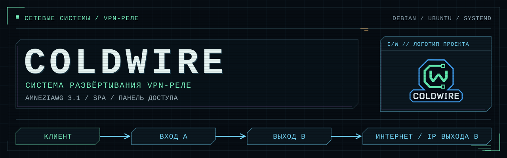
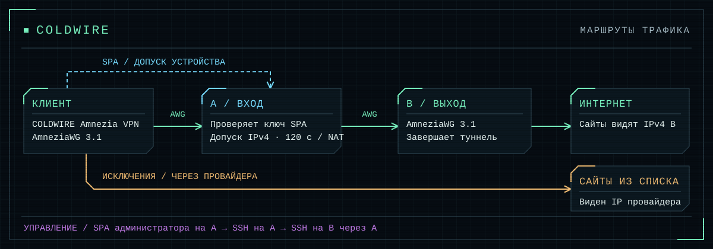

[English](README.md)

COLDWIRE разворачивает VPN AmneziaWG 3.1 на двух серверах. Клиент запрашивает допуск на входном узле по протоколу Single Packet Authorization (SPA). Входной узел пересылает пакеты AmneziaWG на выходной, где завершается туннель. Сайты, открытые через туннель, видят IP выходного узла.

[Скачать панель](https://github.com/bgunn9in/coldwire/releases/latest) · [Установить серверы](docs/ru/access-panel.md) · [Установить VPN-клиент](https://github.com/bgunn9in/COLDWIRE-amnezia-client/blob/feature/spa-admission/docs/spa.ru.md)

## Как это устроено

Клиент подтверждает, что у него есть ключ устройства и он может получить ответ на своём публичном IPv4. Узел A на две минуты разрешает этому адресу доступ к реле. Приложение продлевает допуск, пока VPN подключён. Узел A пересылает зашифрованные пакеты через DNAT и SNAT. Узел B принимает их в AmneziaWG и отправляет трафик в интернет. Адреса и сайты из списка исключений клиент открывает через обычное подключение.

Для доступа по SSH панель использует отдельный ключ SPA. Панель входит на A по ключу SSH и подключается к B через A. На внешнем интерфейсе B принимает VPN и SSH с IPv4 узла A.

## Установка

Понадобятся два VPS на amd64 с Ubuntu 22.04, 24.04 или 26.04 LTS либо Debian 12 или 13. Установщик также служит панелью администрирования. Запустите его на Windows или одной из поддерживаемых версий Linux с CPython 3.10 или новее и клиентом OpenSSH.

1. Скачайте и распакуйте `COLDWIRE-Access-Panel.zip` из [последнего релиза](https://github.com/bgunn9in/coldwire/releases/latest).
2. Запустите `.\setup.ps1` в Windows или `bash setup.sh` в Linux. Введите IPv4, логин и пароль SSH для каждого VPS. Если SSH работает на порту, отличном от 22, добавьте к адресу `:порт`.
3. Импортируйте созданный `client1.vpn` в [COLDWIRE Amnezia VPN](https://github.com/bgunn9in/COLDWIRE-amnezia-client/releases/latest). Подключитесь и проверьте, что сайт, открытый через VPN, видит IPv4 узла B.

В [инструкции](docs/ru/access-panel.md) описаны правила межсетевого экрана провайдера, откат, импорт профилей и управление устройствами. Панель может конвертировать готовый профиль AmneziaVPN, если устройство уже зарегистрировано на B.

Чтобы отдельные адреса открывались напрямую, используйте [списки исключений](docs/ru/lists.md). Данные и сторонние компоненты описаны в [списке источников](docs/ru/sources.md). См. также [лицензии](THIRD_PARTY_NOTICES.md).
