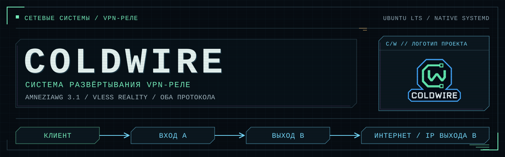
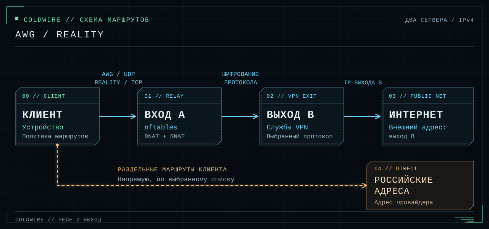

# COLDWIRE



[English](README.md) | Русский

COLDWIRE настраивает VPN на двух серверах Ubuntu. Устройства подключаются
к входному серверу A, а сайты видят IP выходного сервера B. При установке
можно выбрать AmneziaWG 3.1, VLESS с REALITY и XTLS Vision или оба протокола.

Входной сервер пересылает зашифрованный трафик через nftables. VPN работает
на выходном сервере под systemd. Установщик использует готовые бинарные файлы
и не добавляет Docker, Go SDK или панель управления. У AWG и Xray
отдельные службы, ключи и конфигурации.



## Установка

Нужны два чистых VPS с **Ubuntu 22.04, 24.04 или 26.04 LTS amd64** и публичными
IPv4 на сетевых интерфейсах. На каждом должен быть доступ по SSH от root или
с sudo. Для AWG на выходном сервере нужен TUN. Другие версии ОС и VPS
за дополнительным NAT провайдера не поддерживаются. Если облачный образ 26.04
собран для amd64v3, виртуальный процессор должен предоставлять нужные инструкции.
[Проверка платформ](docs/ru/validation-lts.md).

На компьютере нужен Python 3.10+ с venv/pip. Из папки репозитория выполните
одну из команд.

Windows PowerShell:

```powershell
powershell -NoProfile -ExecutionPolicy Bypass -File .\setup.ps1
```

Linux/macOS:

```bash
bash setup.sh
```

Мастер спросит протокол и SSH-данные каждого сервера: IPv4, порт, логин
и пароль. Ввод пароля скрыт. Скрипт установит недостающие серверные пакеты,
создаст ключи, настройки REALITY и файлы подключения. Для парольного sudo
используется пароль SSH, если отдельно не задан другой.

| Режим | Входные порты по умолчанию | Службы на выходном сервере |
|---|---|---|
| AWG | 32497/UDP | AmneziaWG 3.1 |
| REALITY | 443/TCP | VLESS + REALITY + XTLS Vision |
| Оба | Оба порта | AWG и Xray |

Перед установкой разрешите SSH и выбранные VPN-порты в firewall хостера.
Скрипт не может настроить этот firewall через обычный SSH. Если SSH занимает
TCP443, мастер может выбрать свободный TCP8443. При других конфликтах
установка остановится. VPN-порты можно задать явно.

Установщик требует чистые серверы: он не работает поверх старой установки
комплекта, активного UFW или таблиц nftables другого ПО. При первом подключении
мастер доверяет полученному SSH-ключу, а последующие изменения отвергает
до передачи пароля. Для независимой проверки первого подключения задайте
известные отпечатки SSH. [Параметры установки и проверка SSH](docs/ru/deploy.md).

## Файлы подключения

Результат сохраняется в новой папке `private/deployment-<время>-<суффикс>/`:
прямые профили и профили через A, два списка RU и отчёт об установке.
В отчёте и профилях нет SSH-паролей.

Для AWG импортируйте `client-via-entry.vpn`, для REALITY
`xray-client-via-entry.json`. Для Xray также выдаётся TXT со ссылкой `vless://`.
Прямой профиль сохраните для возврата. Для каждого устройства создайте
отдельного клиента. Его прямой профиль и вариант через A используют одни
учётные данные. Если установлены оба протокола, импортируйте два подключения
и выбирайте нужное в приложении.

Если установку входа не подтвердить, через пять минут сработает откат.
Мастер подтверждает её после успешных проверок всех выбранных протоколов.
Если после установки AWG не удалось установить Xray, уже скачанные профили
AWG сохранятся. Скрипт не переключает VPN компьютера и не меняет его маршруты.

Серверами управляют через SSH и командную строку. Созданные профили имеют
клиентскую роль в AmneziaVPN. [Форматы профилей и импорт](docs/ru/profiles.md).

## Добавить устройство

На выходном сервере, установленном мастером, выполните команду нужного протокола:

```bash
sudo python3 /opt/awg-relay-kit/install_exit.py add-client --name phone
sudo python3 /opt/awg-relay-kit/install_xray.py add-client --name phone
```

AWG добавляет клиента без перезапуска серверного процесса. Добавление клиента
Xray ненадолго перезапускает Xray; AWG продолжает работать. Резервное
копирование и восстановление описаны в руководствах
[AWG](docs/ru/native-server.md) и [Xray](docs/ru/xray.md).

## Изменить существующий профиль

Для AWG-профиля, выданного приложением Amnezia на другом выходном сервере:

```powershell
python .\convert_profile.py "C:\secure\client.vpn" "C:\secure\client-via-entry.vpn" --entry ENTRY_IPV4
```

Для клиентского JSON Xray:

```powershell
python .\convert_xray.py "C:\secure\client.json" "C:\secure\client-via-entry.json" --entry ENTRY_IPV4
```

Вместо `ENTRY_IPV4` укажите адрес входа. Оба конвертера сохраняют клиентские
ключи и создают новый файл. Серверы они не устанавливают. Конвертер AWG также
сохраняет адрес управления в администраторском профиле.
[Подробности конвертации](docs/ru/profiles.md).

## Российский трафик напрямую

В AmneziaVPN выберите режим списка сайтов без VPN и импортируйте один файл
через **«Заменить список»**. Объединять файлы не нужно.

| Файл | Подсетей | Расчёт маршрутов Android <13 | Покрытие |
|---|---:|---:|---|
| `ru-direct.amnezia.json` | 1097 | 2004 | Все RU/локальные сети исходного набора и ещё 111 284 160 адресов вне него |
| `ru-services.amnezia.json` | 77 | 751 | RU-выделения выбранных сервисов и локальные сети |

Для сокращения числа маршрутов `ru-direct` направляет часть зарубежных
адресов через провайдера. Пользователь подтвердил работу списка на телефоне;
хеш импортированного файла отдельно не сверялся. В приложенных списках нет
заранее заданных адресов VPN-узлов.

Обновить данные или воспроизвести приложенные списки офлайн:

```powershell
python .\update_lists.py --output .\generated\fresh-lists
python .\update_lists.py --offline --output .\generated\snapshot
```

Каждая команда создаёт ровно два JSON в новой папке. Необязательные параметры
`--entry ENTRY_IPV4 --exit EXIT_IPV4` защищают эти адреса от включения в обход VPN.
[Покрытие, число маршрутов и хеши](docs/ru/lists.md).

## Проверки и ограничения

```powershell
.\.venv\Scripts\python.exe -m unittest discover -s tests -v
```

Все три режима проверены в VM **Ubuntu 22.04, 24.04 и 26.04 LTS** с 1 ядром
и 1 ГБ RAM. [Отчёт 24.04/26.04](docs/ru/validation-lts.md) описывает установку
по SSH, трафик, независимость служб, холодный запуск, обычную перезагрузку A/B,
восстановление и память.
В [отчёте 22.04](docs/ru/validation-protocols.md) также проверены перезагрузка
гостей и полное ожидание пятиминутного отката. [Ранний отчёт AWG](docs/ru/validation-native.md)
содержит отдельный нагрузочный тест. Короткие проверки не определяют
предельную скорость и число клиентов VPS.

Реле разделяет IP входа и выхода и сохраняет шифрование протокола.
Дополнительного слоя туннеля нет; корреляция трафика остаётся возможной.
REALITY не гарантирует обход любого DPI. AWG использует UDP независимо
от номера порта. Порт 32497 выбран по умолчанию с учётом
[проверки совместимости AdGuard](docs/ru/windows-admin-port-diagnosis.md).

Сервер обеспечивает выход по IPv4. Проверьте на устройствах IPv6, DNS/DoH
и KillSwitch. Раздельную маршрутизацию выполняет клиент: он направляет
исключённый трафик через своего провайдера.
[Диагностика](docs/ru/troubleshooting.md) и [технические источники](docs/ru/sources.md).

Профили и резервные копии содержат секреты. Храните их вне Git; в Windows
ограничьте доступ к папке через NTFS ACL. `.vpn` содержит сжатый JSON,
а администраторский файл может включать SSH-доступ. Перед передачей изменённой
копии проверьте файлы и историю. [Подготовка к публикации](docs/ru/publication.md).

Наши скрипты, тесты, документация и оформление доступны по [MIT](LICENSE).
Для сторонних компонентов и адресных данных действуют их условия:
[уведомления о лицензиях](THIRD_PARTY_NOTICES.md).
